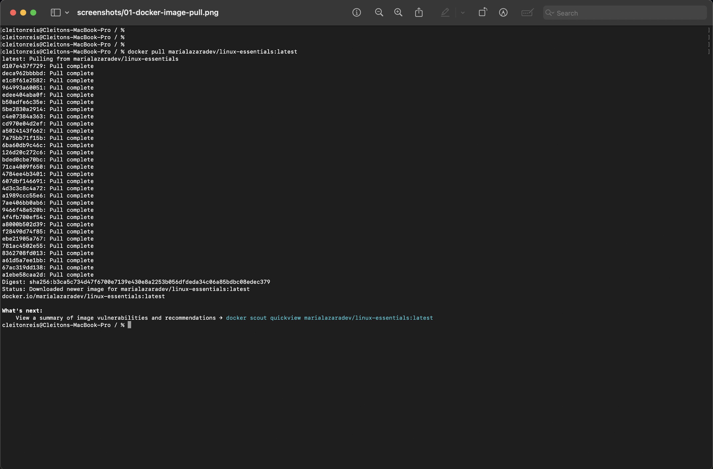
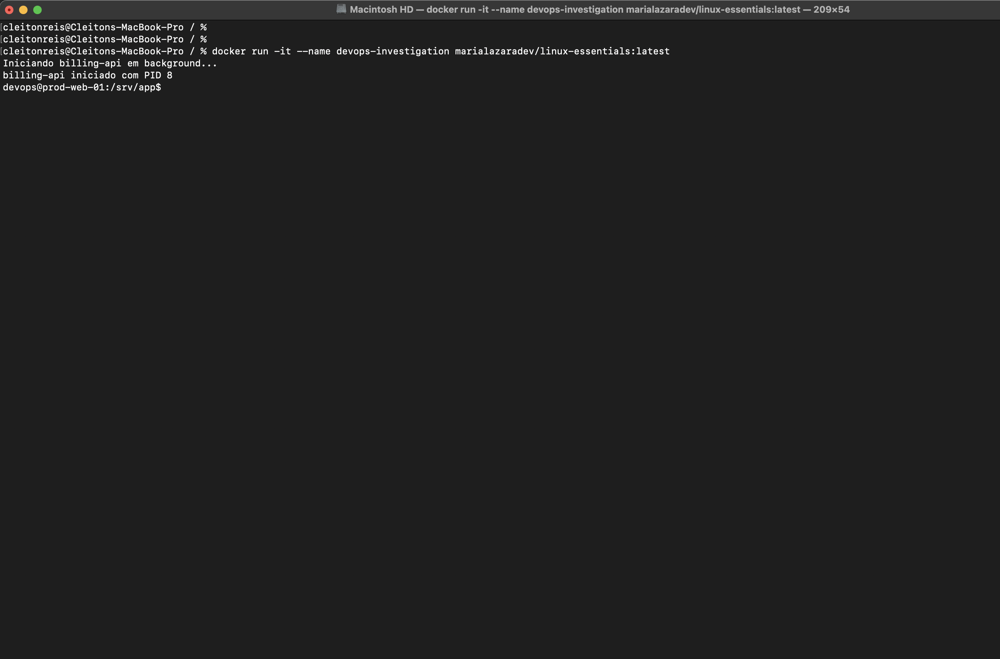

# Environment Setup

## 1. Pulling the Docker Image

### Objective

Download the Docker image required to prepare the Linux Essentials lab environment.

### Command Executed

```bash
docker pull marialazaradev/linux-essentials:latest
```

### Command Explanation

The `docker pull` command downloads a Docker image from a container registry to the local machine.

- `docker pull`: downloads the image.
- `marialazaradev`: image namespace.
- `linux-essentials`: image repository.
- `latest`: image tag.

### Results

The image was successfully downloaded from Docker Hub.

The terminal confirmed:

- All image layers were downloaded successfully.
- The image digest was generated and displayed.
- Docker reported that a newer image had been downloaded.

### Evidence




### Key Learning

Docker images are composed of multiple layers. These layers are used to package application dependencies and the environment required to run containers.

## 2. Creating and Starting the Docker Container

### Objective

Create and start an interactive Docker container using the previously downloaded Linux Essentials image.

### Command Executed

```bash
docker run -it --name devops-investigation marialazaradev/linux-essentials:latest
```

### Command Explanation

- `docker run`: creates and starts a new container.
- `-i`: keeps standard input open.
- `-t`: allocates a pseudo-terminal.
- `--name`: assigns a custom name to the container.
- `devops-investigation`: container name.
- `marialazaradev/linux-essentials:latest`: Docker image used.

### Results

The container started successfully.

The initialization output confirmed:

- The `billing-api` application was started in the background.
- The application process was assigned PID `8`.
- An interactive Linux shell became available.

### Environment Information

| Attribute | Value |
|---|---|
| Container | devops-investigation |
| Linux hostname | prod-web-01 |
| Current user | devops |
| Working directory | /srv/app |
| Application | billing-api |
| Application PID | 8 |

### Key Learning

Docker containers provide isolated execution environments for applications.

The `docker run` command creates and starts a container from an image, while the `-it` flags allow interactive terminal access.

### Evidence



## 3. General System Analysis

This step was performed inside the `devops-investigation` Docker container to collect basic information about the Linux environment.

### Commands executed

**1. Current working directory**

```bash
pwd
```

Output:
```text
/srv/app
```

**2. Current user**

```bash
whoami
```

Output:
```text
devops
```

**3. Kernel and system information**

```bash
uname -a
```

Output:
```text
Linux 65c9803755d1 6.10.14-linuxkit #1 SMP PREEMPT_DYNAMIC Tue Apr 15 16:05:22 UTC 2025 x86_64 GNU/Linux
```

**4. Disk space usage**

```bash
df -h
```

Key results:

| Filesystem | Size | Used | Available | Use |
|---|---:|---:|---:|---:|
| overlay | 59G | 8.2G | 48G | 15% |
| /dev/vda1 | 59G | 8.2G | 48G | 15% |

**5. Memory usage**

```bash
free -h
```

Results:

| Memory | Total | Used | Free | Available |
|---|---:|---:|---:|---:|
| RAM | 7.7Gi | 589Mi | 6.7Gi | 7.1Gi |
| Swap | 1.0Gi | 0B | 1.0Gi | — |

### Key observations

- The current working directory is `/srv/app`.
- Commands are being executed by the `devops` user.
- The environment runs Linux kernel `6.10.14-linuxkit` on `x86_64` architecture.
- The reported root filesystem has 15% disk usage.
- The system reports 7.1 GiB of available memory.
- No swap memory was being used at the time of inspection.

**Status:** Completed.

## 4. Process Verification

This step focused on identifying running processes inside the Linux container.

### Commands executed

**1. List running processes**

```bash
ps aux
```

Lists running processes and displays information such as process owner, PID, CPU and memory usage, process status, and command.

Relevant results:

| PID | Process | STAT |
|---:|---|---|
| 1 | `/bin/bash` | Ss |
| 8 | `python3 /usr/local/bin/billing-api-simulator.py` | S |
| 72 | `ps aux` | R+ |

**2. Filter processes related to billing**

```bash
ps aux | grep billing
```

Uses a pipe (`|`) to send the process list to `grep`, filtering entries containing the word `billing`.

Result:

```text
devops  8  0.0  0.1  14172  10052 pts/0  S   10:25  0:04 python3 /usr/local/bin/billing-api-simulator.py
devops 74  0.0  0.0   3332   1504 pts/0  S+  18:48  0:00 grep billing
```

The PID 74 entry represents the `grep billing` command itself, which appears in the results because its command line contains the searched term.

### Key observations

- The process `billing-api-simulator.py` was identified with PID 8.
- The process was listed with status `S`.
- The filtered search successfully returned the billing simulator process.

**Status:** Completed.